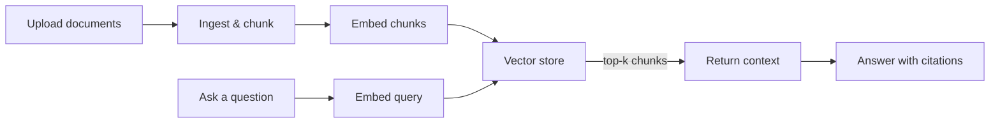

# CogniVault RAG Engine

A Retrieval-Augmented Generation engine built with Next.js. Documents go in one end; answers come out the other with the retrieved context attached, so you can inspect exactly what the engine found before trusting the answer.

**Demo:** deploy with `npm run build && npm start`, or `npm run dev` for development.

  

---

## The Pipeline



1. **Ingest** — upload documents; they're split into chunks.
2. **Embed** — each chunk is vectorized and stored.
3. **Query** — type a question; the engine embeds it, runs a vector search, and returns the top matching chunks alongside the generated answer.
4. **Inspect** — view the raw retrieved chunks to verify the search actually found relevant material.

## Repository Layout

| Path | Purpose |
| --- | --- |
| `src/app/` | Next.js App Router pages and API routes |
| `src/app/api/` | Ingest, embed, and retrieval endpoints |
| `src/lib/rag/` | The engine itself — chunking, embedding, retrieval logic |
| `src/lib/store-instance.ts` | Vector store singleton |

## Tech Decisions

| Decision | Rationale |
| --- | --- |
| Next.js + TypeScript | Single deployable unit, type-safe API routes |
| In-memory vector store (current) | Zero infra for local use; swappable to a persistent DB |
| Simulated generation (current) | Answer generation is mocked until an LLM provider is wired in; retrieval is real |

## Roadmap

- [ ] Wire in OpenAI/Anthropic for actual generative answers
- [ ] Migrate to a persistent vector database (ChromaDB/Pinecone)
- [ ] D3.js graph view of document node relationships

## Running It

```bash
git clone https://github.com/1m1ssher/CogniVault-RAG-Engine.git
cd CogniVault-RAG-Engine
npm install
npm run dev
```

Open `http://localhost:3000`, upload some documents, and start querying.

## License

MIT.
